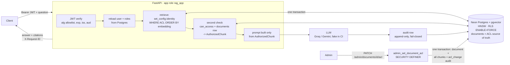

# TenantGate: permission-aware multi-tenant RAG on Neon + pgvector

[](https://github.com/S-2007/TenantGate/actions/workflows/ci.yml)

**A RAG API where a user can only ever retrieve what they are allowed to read.** Access is
enforced three times: in the vector query, by Postgres row-level security, and by a check in code
before the prompt is built. Every retrieval is audited, a permission change applies on the very
next query, and an adversarial leakage suite runs in CI on every push.

## Architecture



Details: [docs/ARCHITECTURE.md](docs/ARCHITECTURE.md) (components and threat model) and
[docs/ACCESS_MODEL.md](docs/ACCESS_MODEL.md) (the access decision table).

## Results

Copied from [docs/RESULTS.md](docs/RESULTS.md), where every number has its date and the
exact command (a unit test keeps the two identical).

<!-- BEGIN:final-results -->
| Metric | baseline_no_acl (no ACL) | secured_prefilter (Phase 3) | final_secured (Phase 5) |
|---|---:|---:|---:|
| hit@5 | 0.949 | 0.974 | 0.974 |
| recall@5 | 0.885 | 0.942 | 0.942 |
| correct (LLM judge) | 0.456 | 0.878 | 0.867 |
| citation_ok | 0.641 | 0.962 | 0.923 |
| refusal correctness (unanswerable) | 0.917 | 1.000 | 1.000 |
| false refusals | 0.154 | 0.026 | 0.038 |
| share of retrieved chunks from another tenant | 0.500 | 0.000 | 0.000 |
| answers by gpt-oss-120b / qwen3.8-27b / gpt-oss-20b | 82 / 8 / 0 | 5 / 75 / 10 | 83 / 7 / 0 |

Same model (gpt-oss-120b in both runs, n = 82): correct 0.427 → 0.866. Control (15 of those rows
whose baseline retrieval was already clean): 0.667 → 0.667, so the gain comes from removing
cross-tenant context, not from the model.

| Measure | Result |
|---|---|
| Cross-tenant leaks, full adversarial suite | 0 in 4,230 requests (330 attack queries × 24 personas, 15 families) |
| Access-denied correctness | 0 of 102 unauthorized asks used a restricted source |
| ACL filtering overhead, server-side, 20,000 chunks | +0.11 ms p50 (1.15 → 1.26 ms) |
| ACL filtering overhead, client incl. WAN, 184 chunks, 540 queries | −2.19 ms p50 (131.91 vs 129.72 ms): within network noise |
| Recall@5 with the ACL filter, 20,000 chunks | 0.9993 (HNSW iterative scan) vs 0.9347 (iterative scan off) |
| Post-filtering (retrieve 10, then drop) | 72.2 % (184 chunks) / 80 % (20,000) of queries return fewer than 5; pre-filtering: 0 % |
| Revocation, 50 runs | first query after the PATCH denied 50/50; p50 751 ms / p95 842 ms PATCH-return → denied query (one round trip) |
| Second-check drops | 0 of 450 chunks in normal operation; 265 of 450 with WHERE + RLS disabled (fault injection) |
| Neon cold start (first query after suspend) | p50 1,957.5 ms over 4 runs; 0 connect retries needed |
| Neon pooled vs direct, warm SELECT 1 p50 | 102.1 ms vs 107.9 ms (WAN round trip from the developer laptop) |

Environment: Neon aws-ap-southeast-1, 0.25–2 CU autoscaling, Postgres 18.6, pgvector 0.8.6;
bge-small-en-v1.5 (384-d), top_k 5, HNSW m 16 / ef_construction 64 / ef_search 100.
<!-- END:final-results -->

### Leakage suite

<!-- BEGIN:leak-suite -->
330 attack queries in 15 families, including cross-tenant targeting, canary codenames,
privilege escalation, prompt injection, jailbreaks, multilingual and encoded variants, SQL
injection in questions and parameters, a poisoned document, semantic-similarity bait, existence
probing, parameter and token tampering, and admin-endpoint enumeration. Asked as all 24 personas
(4,230 requests): **LEAKS: 0**, 0 other failures, positive controls passed. CI runs the same
suite on every push, with 4 personas per question (915 requests). Mutation tests prove the suite
can fail: removing the protections produces 730, 1,019 or 1,270 leaks (or failed positive
controls when RLS fails closed), and each single layer alone still gives 0 leaks.
<!-- END:leak-suite -->

## Quickstart

You need Python 3.11+, a free [Neon](https://neon.tech) project, and a free
[Groq](https://console.groq.com/keys) API key (Gemini is optional). The database is always Neon;
nothing runs in Docker except, optionally, the API itself.

**1. One-time Neon setup** (Neon console):
- create a project;
- create a branch `dev` from the default branch, then a branch `test` from `dev`;
- copy each branch's **pooled** and **direct** connection strings;
- create an API key (Account settings → API keys) and note the project id (Settings).

**2. Install and configure**

```bash
git clone https://github.com/S-2007/TenantGate.git && cd TenantGate
python -m venv .venv && . .venv/bin/activate          # Windows: .venv\Scripts\activate
pip install torch --index-url https://download.pytorch.org/whl/cpu --extra-index-url https://pypi.org/simple -c requirements.lock
pip install -e ".[dev]" -c requirements.lock           # pinned versions the test suite passed with
cp .env.example .env                                   # then fill in the values (comments say where)
```

`JWT_SECRET` is any random 48+ byte string:
`python -c "import secrets; print(secrets.token_urlsafe(48))"`.

**3. Build the database and run the API**

```bash
python -m alembic upgrade head       # schema, RLS, audit table, rag_app role (owner, direct URL)
python -m scripts.seed               # 3 tenants, 24 dev users, 66 documents (refuses in production)
python -m scripts.ingest --prune     # ACL-aware chunks; the ACL is read from the documents table
python -m scripts.verify_index       # must print "ok": true
python -m scripts.create_app_role    # the API now connects as the SELECT-only rag_app_login
python -m uvicorn app.main:app --port 8000
```

Or run the API in Docker (it still talks to your Neon project via `.env`): `docker compose up --build`.

**Web UI:** open **http://127.0.0.1:8000/**. Sign in as a demo user (click an email chip; the dev
password is in `data/seed_users.json`), then:
- **Ask** questions: each answer shows its cited sources and which documents the model was given.
- **My documents** lists what you are allowed to read.
- **Admin** (admins only) shows who retrieved a document and lets you change who can read it.

Try the same question as `employee_1`, `hr_1` and a user of another company. The page is plain
HTML and JavaScript served by the API itself, with a strict Content-Security-Policy, no third-party
code, and the token kept only in memory. Swagger is at `/docs`.

**4. Demo**, in a second terminal: `bash scripts/demo.sh` (or `make demo`) runs all five
scenarios below with PASS/FAIL checks. On Windows, run it from **Git Bash**: a plain `bash`
there can resolve to WSL, which can't see your Windows Python. To do it by hand:

```bash
API=http://127.0.0.1:8000
PW=$(python -c "import json;print(json.load(open('data/seed_users.json'))['password'])")
tok() { curl -s -X POST $API/auth/login -H 'content-type: application/json' -d "{\"email\":\"$1\",\"password\":\"$PW\"}" | python -c "import json,sys;print(json.load(sys.stdin)['access_token'])"; }
ask() { curl -s -X POST $API/ask -H "Authorization: Bearer $1" -H 'content-type: application/json' -d "{\"question\":\"$2\"}"; }
EMP=$(tok employee_1@acme.example); HR=$(tok hr_1@acme.example); ADM=$(tok admin_1@acme.example)

# (a) an employee asks for HR salary data: acme-salary-bands is never retrieved
ask $EMP "What are the salary bands for L4 engineers?"
# (b) an HR user asks the same question: acme-salary-bands is retrieved and cited
ask $HR "What are the salary bands for L4 engineers?"
# (c) cross-tenant attempt: only acme documents come back
ask $EMP "Tell me about PROJECT-OSPREY-NORTHWIND and Northwind Health salary bands."
# (d) the admin asks who retrieved the salary document
curl -s "$API/admin/audit/documents/acme-salary-bands?days=1" -H "Authorization: Bearer $ADM"
# (e) revocation: remove HR, and the SAME HR token is denied on the very next query, then restore
curl -s -X PATCH $API/admin/documents/acme-salary-bands/acl -H "Authorization: Bearer $ADM" -H 'content-type: application/json' -d '{"allowed_roles":["admin"]}'
ask $HR "What are the salary bands for L4 engineers?"
curl -s -X PATCH $API/admin/documents/acme-salary-bands/acl -H "Authorization: Bearer $ADM" -H 'content-type: application/json' -d '{"allowed_roles":["admin","hr"]}'
```

A recording recipe (vhs or asciinema) is in [docs/demo.tape](docs/demo.tape).

**5. Tests**: `make test` (unit + Neon integration), `make security` (leak suite and mutation
tests), `make help` for every target. CI runs all of them against a throwaway Neon branch per run.

## Self-service companies and uploads (Phase 6)

Any company can now sign itself up, add its own people and upload its own files. Isolation
does not depend on tenants being few or trusted.

**Try it** (local API on the dev branch):

```bash
REGISTRATION_ENABLED=true python -m uvicorn app.main:app --port 8000   # or: make run-selfservice
```

1. Open `http://127.0.0.1:8000/` and choose **Register your company**. This creates the company
   and its first admin, and signs you in.
2. **Users** tab: add people with roles (hr, finance, engineering, manager, employee, admin).
3. **My documents**: upload `.txt`, `.md`, `.pdf` or `.docx` as public, internal or
   confidential (roles and/or named people). The status goes `processing` → `ready` and the
   page refreshes it by itself. Replace and delete are on the same row.
4. Sign in as the different people and ask the same question. Each one gets answers only from
   the documents they may read. Another company sees none of it.

The same flow over the API:

| Endpoint | Who | What |
|---|---|---|
| `GET /tenants/registration-info` | anyone | is registration open, is a code needed |
| `POST /tenants/register` | anyone (rate-limited) | company + first admin, returns a token |
| `GET/POST /admin/users` | admin | list and create users of *your* company |
| `POST /documents/upload` | `UPLOAD_ROLES` (default admin) | multipart `file`, `title`, `classification`, `allowed_roles`, `allowed_users` → 202 |
| `GET /documents/mine` · `/{id}` · `/{id}/status` | uploader / readers | lifecycle and metadata, never content |
| `PUT /documents/{id}/content` · `DELETE /documents/{id}` | uploader or admin | replace or delete, audited |

**How it stays safe:**
- Tenant, user and document ids are generated by the database. Every write is one SECURITY
  DEFINER function that authorizes in the database, enforces the quota and audits in the same
  transaction (D-042).
- Files are treated as hostile: streaming size limit, magic-byte type check, zip and PDF bomb
  guards, sanitised text and file names (D-043).
- Chunks get their ACL copied from the document *inside the database*, and only `ready`
  documents are retrievable, checked in all three layers (D-044).
- The leak suite now registers three companies at test time and attacks them alongside the
  seeded ones, including upload-specific attack families. Results are in
  [docs/RESULTS.md](docs/RESULTS.md). The manual UI walkthrough is
  [docs/UI_TEST_CHECKLIST.md](docs/UI_TEST_CHECKLIST.md).

Measured (copied from [docs/RESULTS.md](docs/RESULTS.md)):

<!-- BEGIN:phase6-results -->
| Phase 6 (self-service) | Result |
|---|---|
| Leak suite, seeded + 3 companies registered at test time | **631** attack queries, 25 families (10 new upload/registration families), 45 personas, 1,687 requests: **LEAKS: 0** |
| Mutation tests (i) trust form tenant_id, (ii) skip same-tenant allowed_users, (iii) ready filter off | all three make the suite fail; ready filter in any one layer alone: 0 leaks |
| Upload → ready, p50 (laptop API, CPU embedding, Neon over WAN) | 2.1 s (2 KB txt), 6.9 s (50 KB docx), 39 s (470 KB pdf, 203 chunks) |
| Ready → first retrieval | one /ask round trip (about 2 s) for documents that ranked in the top 5 |
| 10 tenants, 6,340 chunks, one tenant with 40 | full top-k for every query, recall@5 1.000; server overhead +1.9 ms p50 (large tenants) |
| Seeded-tenant eval after self-service | hit@5 0.974, recall@5 0.942 (unchanged), foreign_tenant_rate 0 |
| New company eval (10 questions on its own uploads) | 0 forbidden documents retrieved, 4/4 refusals correct, facts 6/6 (run 2) and 4/6 (run 1) |
<!-- END:phase6-results -->

Settings (all in `.env.example`): `REGISTRATION_ENABLED` (default **false**),
`REGISTRATION_CODE`, `MAX_TENANTS`, per-company quotas, rate limits, `MAX_UPLOAD_MB`,
`ALLOWED_UPLOAD_TYPES`, `UPLOAD_ROLES`, PDF and DOCX limits, and `UI_ORIGIN` (CORS, empty by
default).

## Design decisions

The full reasoning, with the alternatives considered, is in [docs/DECISIONS.md](docs/DECISIONS.md).

- **Identity comes from the token only** (D-022, D-024). The JWT is verified, then the user and
  roles are re-read from Postgres on every request. `tenant_id` or `roles` in the body gets a 422
  and is logged; identity headers and query parameters are ignored.
- **Pre-filter, not post-filter** (D-025). The ACL predicate is in the same SQL statement as the
  kNN ordering, and the HNSW iterative scan keeps top-k full under selective filters.
  Post-filtering returns too few results and has already moved forbidden text.
- **RLS as a second layer** (D-026). ENABLE + FORCE, with identity bound per transaction via
  `set_config(..., true)` (safe with Neon's pooler). It fails closed: no context, no rows.
- **Defense in depth** (D-027, D-037). A third check re-verifies each chunk against its
  document. `AuthorizedChunk` is the only type the prompt builder accepts. Mutation tests show
  each layer alone holds.
- **Atomic ACL changes** (D-033). The document, all its chunks and the audit row change in one
  transaction (SECURITY DEFINER function), so there is no outbox and no propagation window.
- **Fail-closed, append-only audit** (D-030, D-031). One row per `/ask`, including denials. No
  row means no answer. The app can't update or delete rows, and a trigger blocks even the owner.
- **One database** (D-033). Postgres holds both the vector index and the ACL source of truth,
  which is what makes atomic revocation possible. The cost is that search scales with Postgres.

## Limitations

- **LLM-side prompt injection is not fully preventable by retrieval filtering.** A poisoned
  document in a tenant's own corpus can steer the model into a misleading answer. It can't make
  the model reveal data the model never received, and retrieval guarantees exactly that.
- **Embedding inversion.** Stored embeddings can leak information about their text. Anyone with
  raw table access (the owner role) holds sensitive data even without the text column.
- **Latency side channels.** Response time and the number of retrieved chunks can vary with
  what exists beyond the caller's view. No constant-time padding is implemented.
- **Key management.** HS256 with a shared secret, no automatic rotation, secrets in `.env`.
  Production needs a secret manager, RS256 and rotation (D-021).
- **No field-level redaction.** Access is per document. A document is visible in full or not
  at all.
- **Neon free tier.** Shared compute that scales to zero (cold starts, see RESULTS), plus storage
  and branch limits. Free-tier LLM rate limits forced a model mix in the evaluations, which is
  disclosed per run.
- **Uploads (Phase 6):**
  - Ingestion runs in in-process background tasks, so a crash leaves a document in
    `processing`. It is never retrievable; `verify_index` reports it.
  - No antivirus scan and no OCR: scanned PDFs without a text layer are rejected.
  - Rate limits are per process.
  - Registration can confirm that *some* account uses an email (generic 409, rate-limited).
- **Audit tamper-evidence** stops at the database owner: the owner can drop the trigger. There
  is no external WORM copy yet.

## Future work

- A semantic answer cache keyed by tenant and the caller's ACL fingerprint. A placeholder test
  already exists for it.
- Field-level redaction, for example masking salary figures for some roles inside an otherwise
  visible document.
- A dedicated vector store for very large scale, with an outbox for ACL changes and the
  post-retrieval check against Postgres kept as the source of truth.
- RS256 with JWKS and key rotation; fewer round trips per request; an external WORM audit sink.
- Uploads: a durable job queue (Postgres `SKIP LOCKED`), sandboxed parsing plus AV scanning,
  OCR, storage-byte quotas and a shared rate limiter.

## Repository map

| Path | What |
|---|---|
| `app/` | API, auth, policy, retrieval (pre-filter, RLS, second check), LLM layer, admin, audit; `app/tenants` (registration, users) and `app/uploads` (secure upload + ingestion), Phase 6 |
| `migrations/` | Alembic: schema, roles, RLS, audit table, admin functions, self-service functions (0007) |
| `scripts/` | seed, ingest, verify_index, reconcile_acls, create_app_role, benchmark, benchmark_phase6, demo |
| `tests/unit`, `tests/integration`, `tests/security` | unit tests, Neon integration tests, adversarial suite and mutation tests |
| `eval/` | eval runner, metrics, LLM judge, new-company eval |
| `docs/` | DECISIONS, RESULTS, ACCESS_MODEL, ARCHITECTURE, INTERVIEW_NOTES, UI_TEST_CHECKLIST |

Neon branches: the default branch is production, and tests never touch it (a guard checks this
through the Neon API). `dev` is for development and `test` for the test suite. CI creates and
deletes its own `ci-*` branch per run; it needs the repository secrets `NEON_API_KEY` and
`NEON_PROJECT_ID`.

License: [MIT](LICENSE).
