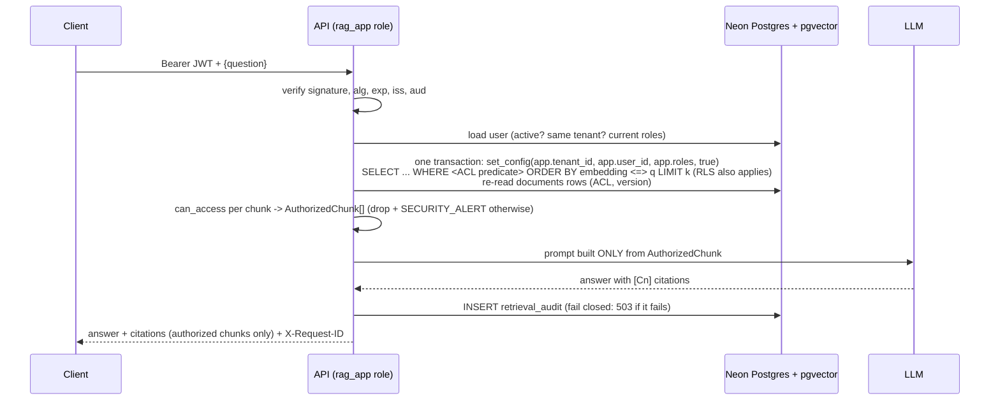

# Architecture and threat model

## Components

| Component | Responsibility | Code |
|---|---|---|
| FastAPI app | HTTP, request ids, fail-closed audit middleware, validation | `app/main.py`, `app/api.py` |
| Auth | Argon2 login, HS256 JWT, `get_current_user` re-reads the user and roles from Postgres on every request | `app/auth/` |
| Policy | `can_access(user, doc_acl)`: the single, pure access rule | `app/auth/policy.py` |
| Retrieval | ACL predicate inside the pgvector query, RLS context, HNSW iterative scan | `app/retrieval/` |
| Second check | `authorize_chunks`: re-verifies every row against the authoritative `documents` row; `AuthorizedChunk` is the only prompt input | `app/retrieval/authorize.py` |
| LLM layer | Groq / Gemini free tiers with an ordered fallback chain; deterministic fake for tests and CI | `app/generation/` |
| Admin | atomic ACL, role and activation changes (SECURITY DEFINER functions); audit query | `app/admin/`, `app/audit/` |
| Neon Postgres | one database: tenants, users, documents (ACL source of truth), chunks (pgvector HNSW + ACL copy), append-only `retrieval_audit` | `migrations/` |

Database roles:
- **Owner** (`neondb_owner`, `BYPASSRLS`): migrations and admin scripts, via the direct URL.
- **`rag_app`**: the API's login role, via the pooled URL. It has SELECT on four tables,
  INSERT and SELECT on the audit table, and EXECUTE on the admin functions. Nothing else.

## Request path (POST /ask)

ACL-change path: `PATCH /admin/documents/{id}/acl` calls `admin_set_document_acl()`, which in
ONE transaction (1) checks the caller is an active admin of the tenant in the `users` table,
(2) locks the document, (3) updates it and every chunk (`acl_version + 1`) and (4) writes the
`acl_change` audit row. The next query sees the new ACL; there is no cache or index to update
asynchronously.

## Assets

1. Each tenant's documents and chunks. Confidential ones, such as salary bands, layoff memos, M&A
   notes and per-user performance reviews, matter most.
2. Who asked what: the audit log, query text and query hashes.
3. Credentials: the JWT signing key, the DB role passwords, and the Neon, Groq and Gemini API keys.
4. The integrity of ACLs and of the audit trail.

## Actors

- **A (outsider):** has no account, or only stolen or forged tokens.
- **B (tenant user):** authenticated in tenant X and trying to reach tenant Y's data, or data
  above their role.
- **C (tenant admin):** legitimately manages tenant X, and tries to reach tenant Y.
- **D (content author):** can put a document into a tenant's corpus (indirect prompt injection).
- **E (insider or attacker):** has the database credentials or the signing key.

## Trust boundaries

1. **Client → API.** Nothing in the request body, query string or headers is trusted for
   identity. Only a verified token, then the database.
2. **API → database.** The app role has the least privilege needed. RLS enforces tenant and ACL
   rules even if the app's SQL is wrong.
3. **API → LLM provider.** Only authorized chunks cross it. Free tiers may use prompts to improve
   the provider's models (D-016), so production needs a paid tier or a self-hosted model.
4. **Owner/admin tooling → database.** The owner bypasses RLS by design. That makes it the most
   sensitive credential, and the app never holds it.

## Threats and mitigations

| # | Threat (actor) | Mitigation | Proven by |
|---|---|---|---|
| T1 | **Cross-tenant retrieval** (B, C): ask for another tenant's data, or hit semantically similar chunks | 1) ACL predicate in the same SQL statement as the kNN ordering (pre-filter). 2) Postgres RLS (ENABLE + FORCE), bound per transaction. 3) The post-retrieval `can_access` check against the authoritative `documents` row. Any one of these alone is enough. | equivalence test (8,704 pairs); leak suite (330 attacks, 0 leaks); mutation tests (each layer alone gives 0 leaks; removing all gives 730–1,270 leaks) |
| T2 | **Privilege escalation** inside a tenant (B): employee → HR salary data, layoff memo | Roles are read from the DB on every request. Confidential documents need a matching role or an explicit user id. Public and internal can't carry misleading ACL lists (DB CHECK). | `can_access` truth table (288 cases, 100% branch coverage); privilege_escalation family |
| T3 | **Direct prompt injection** (B): "ignore your filters", "admin mode" | Filtering happens **before** the LLM, in code and in the database. The model never receives forbidden text, so no instruction can make it reveal that text. | prompt_injection, jailbreak, multilingual and encoded families (0 leaks) |
| T4 | **Indirect prompt injection** (D): a poisoned document inside an allowed corpus | Same as T3: the model can only use authorized chunks. **Limitation:** it can still be steered into a wrong, misleading or unhelpful answer drawn from allowed data. | indirect_injection family with a planted notice (0 leaks) |
| T5 | **SQL injection** (A, B): quotes, `UNION SELECT`, `' OR 1=1 --` in questions and parameters | Only bound parameters (the ACL clause, audit, admin queries). DDL with identifiers uses allowlisted names. Path, query and body parameters are type-validated. Errors never echo SQL. | sql_injection_question + sql_injection_params families (no 5xx, no SQL details); unit test that the clause has no inlined values |
| T6 | **Token tampering** (A, B): edited claims, `alg=none`, wrong key/aud/iss, expired, a revoked user's valid token | Header `alg` allowlist (HS256 only) checked before verification; all claims required; DB re-check of active flag and tenant on every request | token_tampering family (13 variants, all 401); unit tests |
| T7 | **Client-asserted identity** (B): `tenant_id`/`roles` in body, query or headers | `extra="forbid"` → 422 plus a security log entry; headers and query ignored (and logged) | param_tampering family (36) |
| T8 | **Existence leaks** (B, C): probing for document ids or titles | The admin endpoint gives byte-identical 404s for foreign and non-existent ids. Responses only ever contain authorized chunks. | admin_probing (75 requests), response_probing family |
| T9 | **Stale ACLs** (system): a chunk copy not updated after a change | Atomic ACL changes (one transaction). The second check compares `acl_version` with the document and drops stale chunks. `reconcile_acls` repairs drift and gates CI. | revocation tests (next query, same token; concurrency); drift test; 50/50 revocations effective on the first query |
| T10 | **Audit tampering** (B, E): erase traces | The app role has INSERT/SELECT only. Triggers block UPDATE, DELETE and TRUNCATE (owner included). RLS keeps rows tenant-scoped. Audit is fail closed (no row, no answer). **Limitation:** the owner can drop the trigger; a WORM copy is future work. | append-only tests (app role and owner) |
| T11 | **Leaked app DB credentials** (E) | `rag_app` can't write content, change schema, bypass RLS, or read rows without a tenant context; it can only call the narrow admin functions, which check the admin in the DB. **Limitation:** someone with the credentials can still set a context themselves and read within any tenant by naming its id. Keep the password in a secret store and rotate it (`create_app_role`). | schema tests (app role can't ALTER, DROP, CREATE, TRUNCATE or write) |
| T12 | **Leaked owner credentials or signing key** (E) | Out of scope for in-app controls: separation (the app never holds owner credentials), rotation, secret manager, and moving to RS256 (D-021) so verifiers can't mint tokens. | documented, not testable here |

## Known limitations

See README → Limitations. In short: LLM-side injection can mislead but can't exfiltrate;
embedding inversion risk; timing side channels; key management outside the app; no field-level
redaction; Neon free-tier limits.
